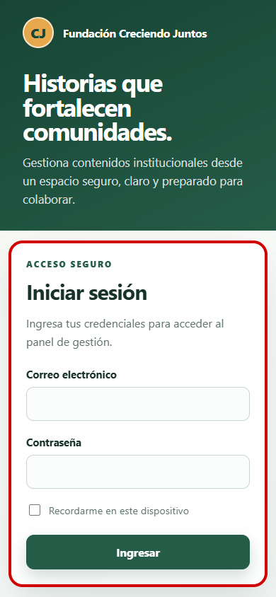

# Evidencia visual: login responsive

- **Identificador:** VIS-AUTH-001
- **Requisito asociado:** Hito 1.2 — pantalla de inicio de sesión accesible y responsive.
- **Descripción:** comprobación visual del formulario de autenticación en un viewport móvil de 390 × 844 píxeles.
- **Resultado esperado:** la marca, instrucciones, campos, opción «Recordarme» y acción «Ingresar» se presentan con jerarquía clara, sin desbordes horizontales y con controles legibles.
- **Resultado obtenido:** todos los elementos se muestran dentro del ancho disponible; el botón principal es visible, los campos mantienen etiquetas asociadas y la consola del navegador registra cero errores y cero advertencias.
- **Entorno:** aplicación local servida por Nginx mediante Docker Compose y recorrida con Playwright CLI.
- **Commit:** `f6123f7` (`feat(auth): mejora experiencia visual del login`).

El recuadro rojo de la captura señala el formulario evaluado. El recuadro se aplicó temporalmente en el navegador para la evidencia y no forma parte del CSS de producción.

