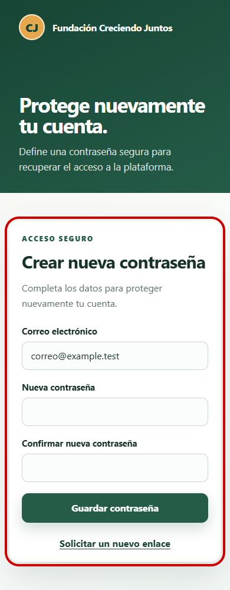
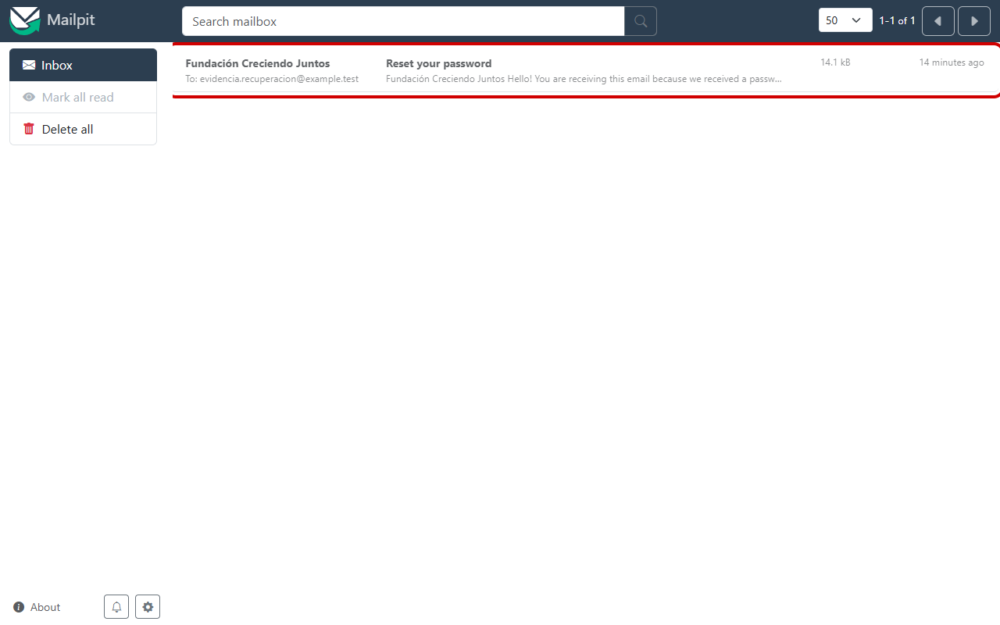

# Evidencia Hito 1.3 — flujo completo de recuperación

- **Identificador:** EVI-AUTH-REC-002.
- **Requisito:** recibir un enlace funcional y establecer una nueva contraseña mediante un token temporal.
- **Commit evaluado:** `22a5ebb`.
- **Entorno:** Docker, MySQL, Mailpit y Chromium mediante Playwright.
- **Esperado:** el correo llega a Mailpit, su enlace responde correctamente y muestra el formulario de nueva contraseña.
- **Obtenido:** Mailpit recibió 1 mensaje para una cuenta ficticia; el enlace respondió HTTP 200 y presentó el formulario esperado.
- **Vigencia comprobada:** el correo informa 60 minutos; las pruebas rechazan tokens expirados a los 61 minutos.
- **Seguridad comprobada:** token inválido, expirado o reutilizado no cambia la contraseña; PHPUnit usa SQLite aislado.
- **Vista móvil:** 390 × 1000 píxeles, sin desborde horizontal y con todos los controles visibles.
- **Consola:** 0 errores y 0 advertencias.
- **Señalización:** los recuadros rojos identifican los elementos evaluados.
- **Datos:** las direcciones usan el dominio reservado `example.test`; ninguna captura expone tokens ni contraseñas.

## Formulario de nueva contraseña

## Correo recibido en Mailpit

