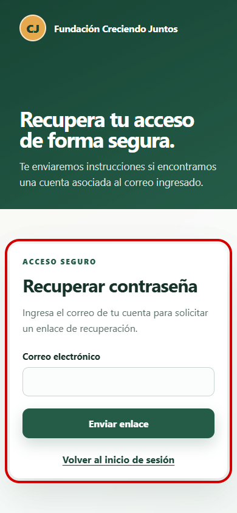

# Evidencia Hito 1.3 — solicitud de recuperación móvil

- **Identificador:** EVI-AUTH-REC-001.
- **Requisito:** solicitar recuperación de contraseña desde una pantalla accesible y responsive.
- **Commit funcional del recorrido visual:** `5023ed7`.
- **Commit de la captura:** `32a19c9`.
- **Entorno:** aplicación local con Docker y navegador Chromium mediante Playwright.
- **Resolución:** 390 × 844 píxeles.
- **Esperado:** título, instrucciones, correo, acción principal y regreso al login visibles, sin desborde horizontal.
- **Obtenido:** todos los elementos permanecen visibles, etiquetados y contenidos dentro del ancho móvil.
- **Consola:** 0 errores y 0 advertencias.
- **Señalización:** el recuadro rojo identifica el formulario evaluado.
- **Datos:** la captura no contiene información personal ni credenciales.

